# T-28 · Web y app de FOM: qué es distinto y cómo igualarlo

16 oct 2026 · Solo análisis. No se cambió nada en ningún repositorio.

## En pocas palabras

Ya se parecen mucho en lo básico:
- el mismo fondo noche y los mismos grises;
- la misma letra (Spline Sans);
- los mismos iconos (el mismo dibujo con el mismo grosor de trazo);
- la misma pantalla de entrada (globo, logo, «Inicia sesión») y el mismo aviso de error, «No pudimos cargar esto» con «Reintentar».

Lo que más cambia de una a otra:
1. **La marca.** La app dice «Control de Flotas» con un cuadrito «CF», en vez del logo de FOM. Además pinta el azul de cada empresa, mientras la web usa siempre el azul FOM.
2. **La forma de las piezas.** Los botones son redondeados en la web y en píldora en la app. Las tarjetas y las etiquetas tienen radios distintos. Las tarjetas de la web tienen borde y las de la app no.
3. **Qué se muestra y con qué nombre.** El Resumen, Mantenimiento, Reportes, Perfil y el inicio del conductor cuentan cosas distintas o las llaman distinto. Ejemplos: «Crear orden» frente a «+ ODT», o «Reportes» frente a «Generar reporte».
4. **Pantallas que un lado tiene y el otro no.** Eventos y SOS, Jornadas y los documentos de la empresa no existen en la app. La inspección del conductor no existe en la web.

## Cómo se hizo

**Web:**
- Panel en modo demostración: `npx vite --mode demo --port 5198`.
- Se bloqueó todo lo que no fuera localhost, salvo Mapbox y las fuentes. Solo se bloqueó `res.cloudinary.com`.
- Capturas a 1440×900 y a 390×844 de los tres roles: supervisor, conductor y admin FOM.

**App:**
- Se exportó la versión web sin servidor de FOM (`EXPO_NO_DOTENV=1`). Antes se verificó que la dirección del servidor real no quedaba dentro del paquete.
- Se sirvió en localhost:8098 con el mismo bloqueo.
- Capturas a 390×844.

**Datos de la app:** en modo simulado la app trae pocos datos, así que muchas pantallas salen vacías o con error. Para las pantallas con datos se usaron las capturas que ya había en `comparativa/app-diseno-web/` y `apk/tablet-3.png`.

**Medidas:**
- Web: se midieron sobre el panel ya pintado (estilos calculados en Edge), en `medir_web.txt`.
- App: se leyeron en el código, en `src/theme/tokens.ts` y en los componentes.

**Después:** se apagaron los servidores y se borró la exportación de la app (llevaba el token público de Mapbox).

Archivos de trabajo:

| Qué | Dónde (en `t28/`) |
|---|---|
| Capturas web | `web/` |
| Capturas app | `app/` |
| Comparativas lado a lado | `lado/` |
| Scripts | `cap_web.py`, `cap_app.py`, `medir_web.py`, `lado_a_lado.py`, `servir_app.py` |

---

## 1. Capturas lado a lado (web escritorio | web móvil | app)

| Pantalla | Imagen | Lo que se ve |
|---|---|---|
| Entrar | 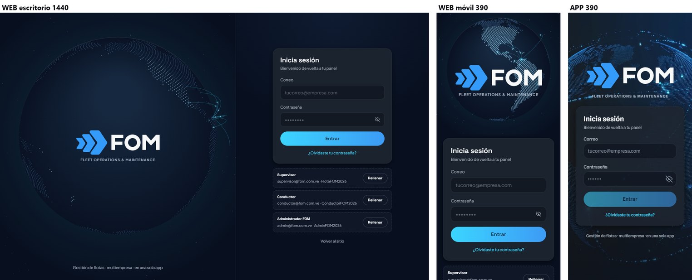 | Casi idénticas. En la app, «Entrar» sale apagado hasta que se llenan los campos; en la web siempre está encendido. |
| Resumen (supervisor) | 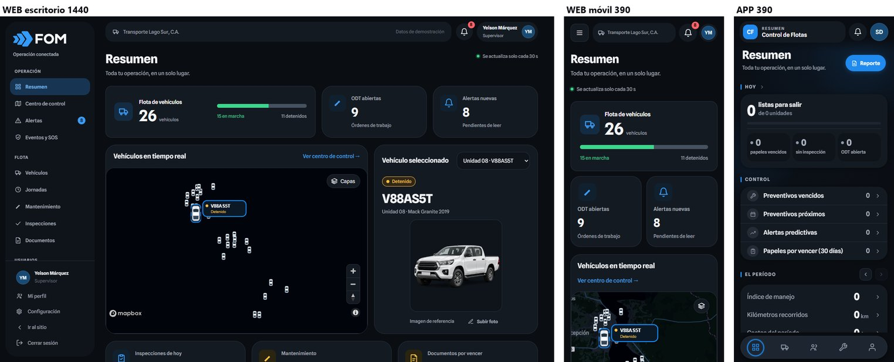 | El contenido es otro: la web muestra flota, ODT, alertas, mapa, vehículo y «Hoy, en orden»; la app muestra «Hoy», «Control» y el mes. El encabezado de la app dice «Control de Flotas». |
| Menú / navegación | 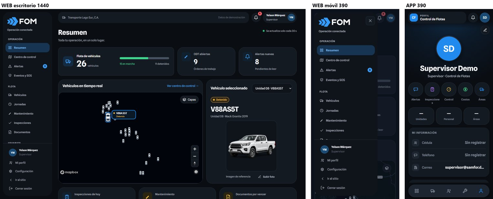 | La web tiene un menú lateral con 11 entradas con nombre. La app tiene una barra abajo con 5 iconos sin nombre. |
| Vehículos | 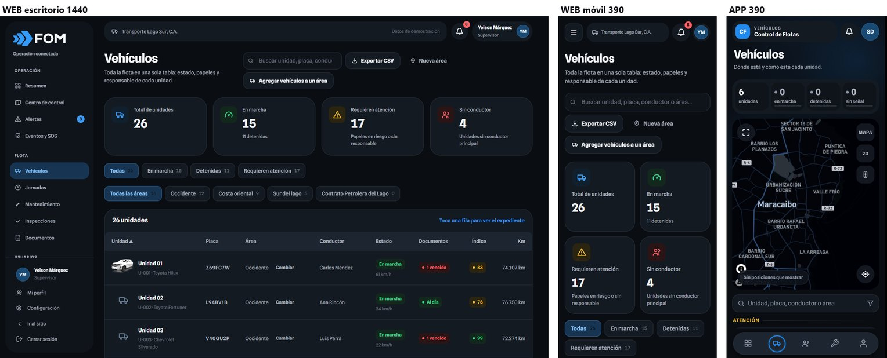 | La web usa una tabla con 4 cifras y filtros en chips. La app usa una tira de 4 cifras, un mapa y una lista agrupada por «Atención» / «Sin novedad». |
| Mapa | 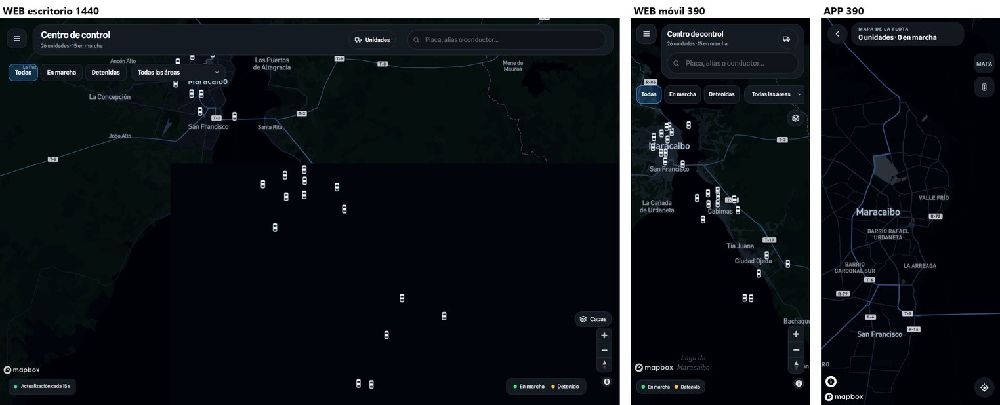 | La web lo llama «Centro de control»; la app, «Mapa de la flota» (se entra desde Vehículos). |
| Ficha de unidad | 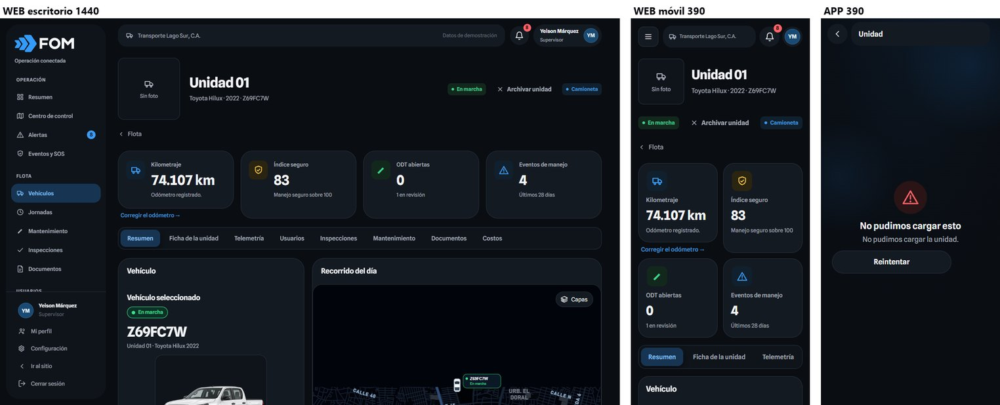 | La web tiene 8 pestañas; la app, una sola página con secciones. En modo simulado la app da error. |
| Usuarios | 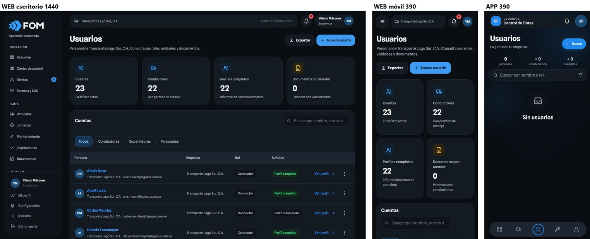 | La web usa tabla y 4 cifras; la app, lista y 3 cifras. El botón es «Nuevo usuario» en la web y «Nuevo» en la app. |
| Mantenimiento | 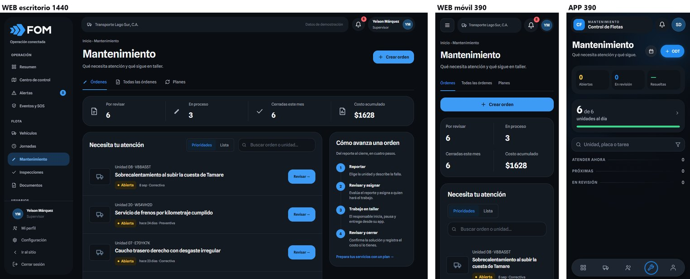 | Las cifras son otras: la web cuenta Por revisar / En proceso / Cerradas este mes / Costo; la app, Abiertas / En revisión / Resueltas. El botón es «Crear orden» en la web y «+ ODT» en la app. |
| Inspecciones | 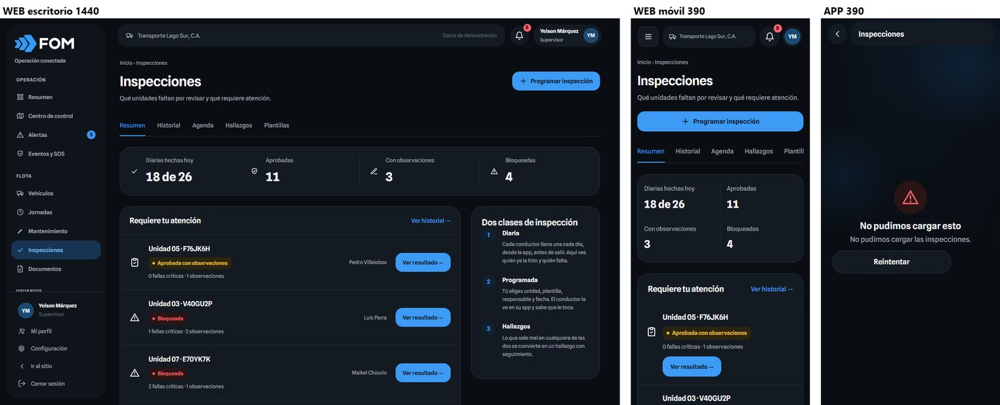 | La web tiene 5 vistas (Resumen, Historial, Agenda, Hallazgos, Plantillas); la app, 2 (Hoy, Historial). |
| Documentos | 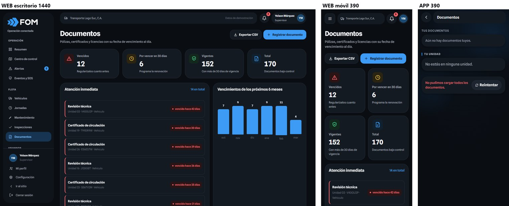 | La web muestra los papeles de toda la empresa; la app, solo los de la persona y su unidad. |
| Alertas | 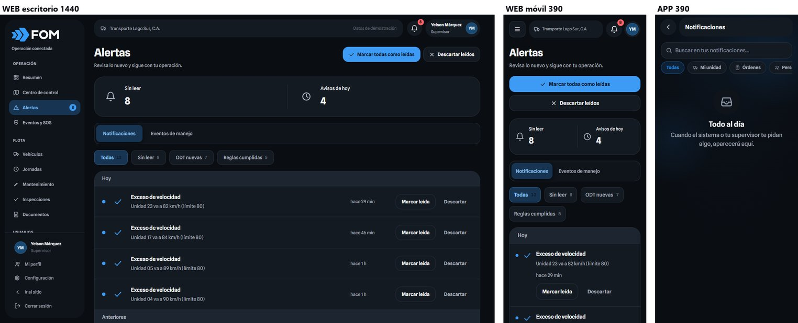 | Los filtros y las pestañas son distintos. Para el conductor, la app la llama «Notificaciones». |
| Reportes | 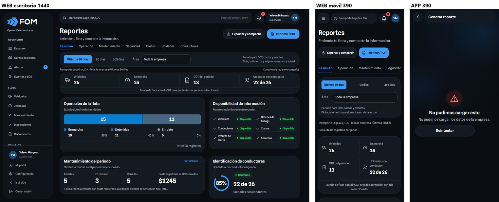 | La web es un tablero con exportar; la app es un formulario «Generar reporte» que saca un PDF. |
| Perfil | 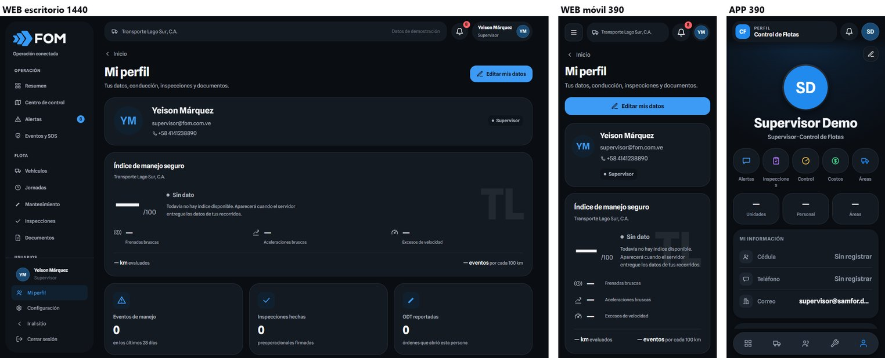 | La web muestra identidad, índice de manejo y cifras con pestañas. La app muestra foto grande, botones de acceso, cifras, «Mi información» y «Cerrar sesión». |
| Inicio del conductor | 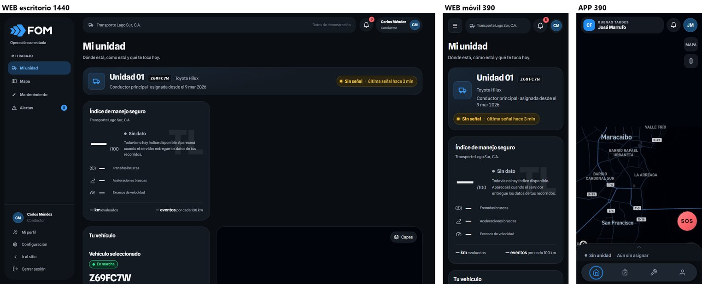 | La web es «Mi unidad» con tarjetas; la app es un mapa a pantalla completa con una hoja desplegable y el botón SOS. |
| Mantenimiento del conductor | 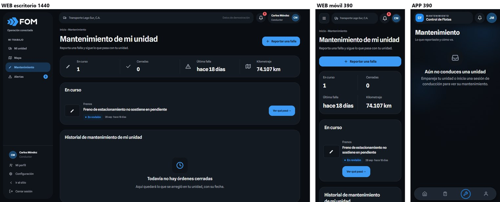 | Mismo propósito. Los títulos son «Mantenimiento de mi unidad» en la web y «Mantenimiento» en la app. |
| Admin: inicio | 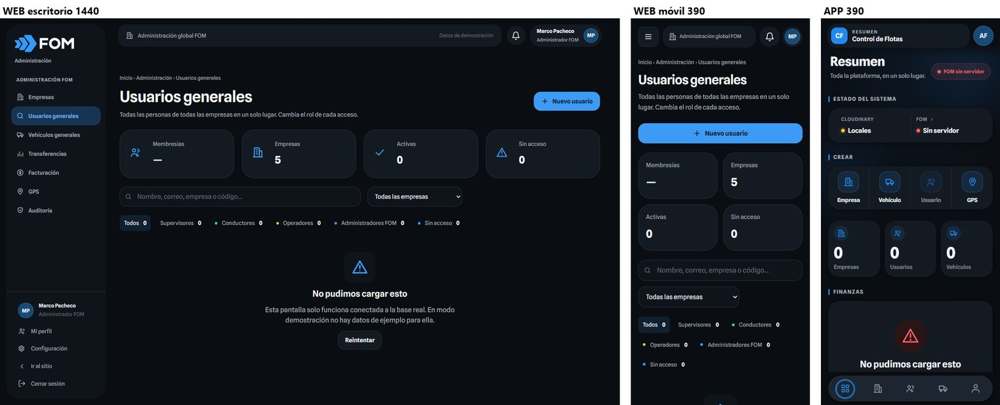 | La web abre en «Usuarios generales»; la app, en un «Resumen» con estado del sistema, crear y finanzas. |
| Admin: empresas | 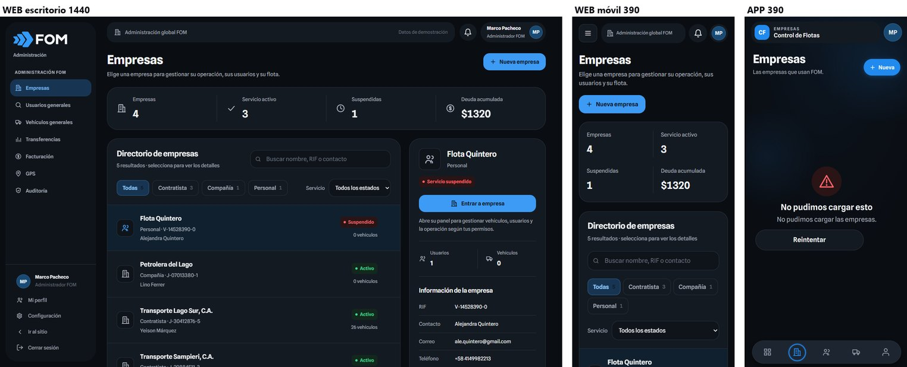 | La web muestra un directorio con ficha al lado; la app, una lista agrupada por tipo. |
| Admin: GPS | 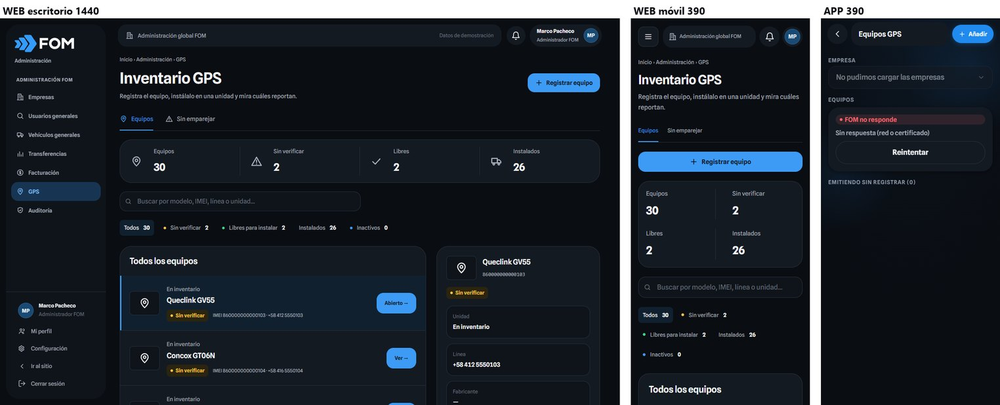 | La web lo llama «Inventario GPS»; la app, «Equipos GPS» (se entra desde «Crear»). |
| Errores (app) | 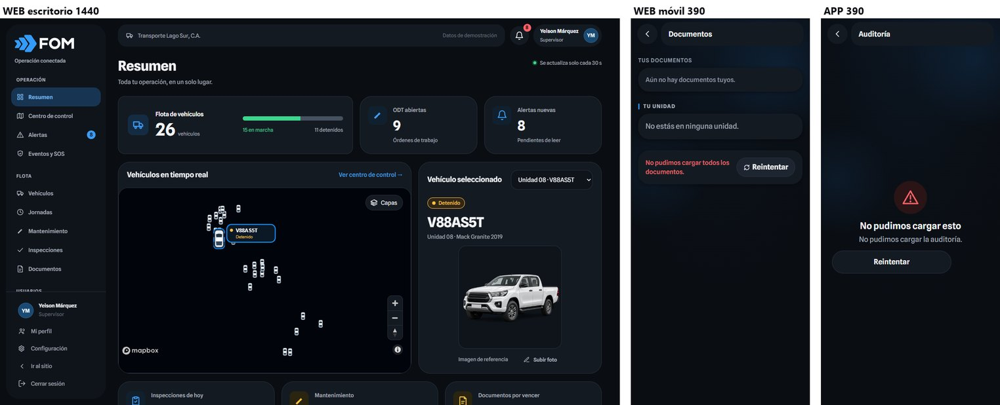 | La app usa dos estilos de error: centrado con icono, y en línea roja (Documentos). |

---

## 2. Tabla de diferencias

Columnas: **Gana** = qué lado se copia; **Prio** = prioridad (alta, media o baja).

### Marca y color

| # | Pantalla | Qué es distinto | Gana | Cambio concreto (archivo · token/valor) | Prio |
|---|---|---|---|---|---|
| 1 | Todas (app) | Sin empresa, el encabezado dice «Control de Flotas» con un cuadrito «CF» sobre #208AEF. La web muestra el logo FOM. | web | `fom-driver-juan/src/theme/brand.ts`: `DEFAULT_BRAND = { name: 'FOM', primaryColor: '#3D9BF5', logo: null, logoKey: 'fom' }`, para que `encabezado-fom.tsx` pinte `LogoFomCuadrado`. Revisar que `types.ts`/`CompanyBrand` acepte `logoKey`. | **alta** |
| 2 | Todas | Color de acento: la web fija el azul FOM #3D9BF5 con texto #08121C (`redesign.css:32`). La app usa el color de cada empresa (por defecto #208AEF, texto blanco). | web (marca FOM); la empresa pone solo su logo (ver memoria «Logo por empresa») | App `src/theme/createTheme.ts`: `primary` fijo `#3D9BF5`, `onPrimary` `#08121C`, sin usar `brand.primaryColor`. El texto blanco sobre #208AEF/#3D9BF5 no llega al contraste mínimo (≈2,9:1); el oscuro da ≈7:1. **Lo decide Marco.** | **alta** |
| 3 | Estado «activo» (menú, chips, pestañas) | La web usa fondo #173553 con texto #8BC6FF (#75B9FA en el menú). La app usa un aro azul en la barra y `primary`@14 % en los filtros. | web, para chips y pestañas. El aro de la barra de la app se queda. | App `src/theme/tokens.ts` (dark): nuevos `activeSurface:'#173553'`, `onActive:'#8BC6FF'`, `activeBorder:'#2D5D88'` (más su tipo en `types.ts`). Usarlos en `pastilla-filtro.tsx`, `riel-opciones.tsx` y `segmented-control.tsx`. | media |
| 4 | Bordes | El borde fuerte es #394655 en la web (`redesign.css:9`) y #39424F en la app y en `panel.css`. | app (es el token original) | Web `src/styles/redesign.css:9` → `--e-borde-fuerte: #39424f`. | baja |

### Forma, letra y tamaños

| # | Pantalla | Qué es distinto | Gana | Cambio concreto (archivo · token/valor) | Prio |
|---|---|---|---|---|---|
| 5 | Tarjetas | La web dibuja borde de 1 px #262E39 sin sombra, con radio 28 en escritorio y 24 en móvil. La app no pone borde, usa sombra `0 2 10 rgba(0,0,0,.4)` y radio 24. | radio 24 en las dos; borde de la web | App `src/components/card.tsx`: `borderWidth:1, borderColor: colors.border`, sin sombra en oscuro (`tokens.ts buildShadows.card` → `none` en dark). Web `src/styles/apariencia.css:6` `--apariencia-radio: 24px` (hoy 28). | media |
| 6 | Botones | La web usa radio 16, alto 44 y texto 14/600 (`apariencia.css:94`). La app usa píldora (999), alto 48 y texto 16/600. «BotonNuevo» va en píldora, con alto 40 y texto 13. | app: píldora, que es la regla de marca | Web `src/styles/apariencia.css:94`: quitar `.pnl-btn` de esa lista y añadir `.pnl.fom-dark[data-diseno] .pnl-btn{border-radius:999px}`. Lo mismo en `redesign.css:69` (`.fom-dark .pnl-btn`, 12 → 999px). El alto puede quedar en 44 en la web y 48 en la app (ver §4). | media |
| 7 | Chips y etiquetas | La web: chip con radio 12 y alto 40; etiqueta (`pnl-tag`) con radio 8 y 12/600. La app: chip y pastilla en píldora, 12/600 y alto 22. | regla de marca «piezas 10» | Web `apariencia.css:95` → `.pnl-tab,.pnl-chip{border-radius:10px}`; `redesign.css:79` `.pnl-tag` radio 8 → 10px. App `src/components/chip.tsx:37-38` y `pastilla.tsx:41,45`: `radii.pill` → `radii.sm` (10). | baja |
| 8 | Campos y buscador | Las dos usan radio 16. La web mide 46 de alto con fondo `--e-sup-baja` #0F141B; la app, 44 con fondo `surface` #141A22. | web (fondo hundido, se distingue mejor de la tarjeta) | App `src/components/search-bar.tsx` y `text-field.tsx`: fondo `colors.surfaceSunken`, alto 46. | baja |
| 9 | Ventanas y hojas | La web abre modales con radio 28. La app usa `hoja-modal` con radio 32 y `bottom-sheet` con 28. | 28 | App `src/components/hoja-modal.tsx`: radio `radii.xl` (28), no `xl+4`. | baja |
| 10 | Encabezado | La web tiene una barra superior con empresa, «Datos de demostración», campana y avatar. La app usa una cápsula con radio 20 (suelto), la sección en MAYÚSCULAS y el nombre de la marca. | app en móvil (es su patrón); igualar radios y textos | App `src/components/encabezado-fom.tsx` y `screen-header.tsx`: radio 20 → `radii.lg` (24), igual que la barra de la web (`apariencia.css:100`, radio 28 → 24). | baja |
| 11 | Títulos de pantalla | La web: 32/700, −0,8 en escritorio y 28 en móvil; bajada 14/1,5. La app: 28/32, 700, −0,6; bajada 13/18. | web | App `encabezado-fom.tsx` (`TituloPantalla`): bajada 14/20 y tracking −0,8. | baja |
| 12 | Títulos de sección | La web pone el título dentro de la tarjeta, en frase normal, 17/600 («Vehículos en tiempo real»). La app pone «HOY», «CONTROL», «UNIDAD» fuera de la tarjeta, en MAYÚSCULAS 11,5/700, con una barrita azul. | web, para que se lean igual | App `src/components/etiqueta-seccion.tsx`: frase normal, 15/600, sin MAYÚSCULAS; la barrita es opcional. Revisar los textos en `panel/index.tsx`, `unidad.tsx` y `mi-perfil.tsx`. | media |

### Navegación y nombres

| # | Pantalla | Qué es distinto | Gana | Cambio concreto (archivo · token/valor) | Prio |
|---|---|---|---|---|---|
| 13 | Barra de navegación (app) | Solo iconos, sin nombre. La web siempre escribe el nombre. | web (que se entienda igual) | App `src/components/app-tab-bar.tsx`: nombre bajo cada icono, 11/14, 600, `textMuted` y `primary` si está activo; alto 56 → 64. | **alta** |
| 14 | Nombres de pestañas | La app dice «Perfil»; la web, «Mi perfil». El conductor tiene «Inicio» en la app y «Mi unidad» en la web. | — | App `app/panel/_layout.tsx:74`, `admin/_layout.tsx:63` y `(driver)/_layout.tsx:117`: «Mi perfil». `(driver)/_layout.tsx:96`: «Mi unidad». | media |
| 15 | Resumen supervisor | Bloques distintos. Web: flota en marcha/detenida, ODT abiertas, alertas nuevas, mapa, vehículo, inspecciones de hoy, mantenimiento, documentos por vencer, ranking y «Hoy, en orden». App: listas para salir, papeles vencidos, sin inspección, ODT, preventivos vencidos/próximos, alertas predictivas, papeles por vencer, índice, km y costos. | mezcla: un mismo «núcleo» en las dos | Las dos deben mostrar, en este orden: **(1)** Flota: total, en marcha y detenidas; **(2)** Listas para salir (de la app); **(3)** ODT abiertas; **(4)** Alertas sin leer; **(5)** Documentos por vencer; **(6)** Inspecciones de hoy. Después, cada lado lo suyo (la web, mapa y ranking; la app, «Control» y el mes). Web `src/panel/modulos/Resumen.jsx`; app `src/app/panel/index.tsx`. | **alta** |
| 16 | Mantenimiento | Estados de ODT: 9 en la web (agrupados en 4) y 3 en la app. Marco ya decidió el 15 oct: **3 estados (Abierta / En revisión / Resuelta)**. Cifras de arriba distintas. Botón «Crear orden» frente a «+ ODT». | app (decisión de Marco); el botón, «Nueva ODT» en las dos | Web `src/panel/modulos/Mantenimiento.jsx` (y `listar-odts.js`, `historial-odt.js`): cifras «Abiertas / En revisión / Resueltas / Costo del mes» y botón «Nueva ODT». Subtítulo común: «Qué necesita atención y qué sigue.». App `src/app/panel/mantenimiento.tsx`: botón «Nueva ODT» (hoy «ODT»). | **alta** |
| 17 | Textos de cabecera | Bajadas distintas para lo mismo. Vehículos: «Toda la flota en una sola tabla…» frente a «Dónde está y cómo está cada unidad.». Usuarios: «Personal de {empresa}…» frente a «La gente de tu empresa.». Botón «Nuevo usuario» frente a «Nuevo». Reportes frente a «Generar reporte». Alertas frente a «Notificaciones» (conductor). | una sola frase por pantalla | Usar la tabla de §5 («Glosario común»). Web: `Flota.jsx`, `AdminUsuarios.jsx`. App: `panel/flota.tsx`, `panel/personal.tsx`, `reportes.tsx`, `mis-notificaciones.tsx`. | media |
| 18 | Vehículos: cifras | Web: «Total de unidades / En marcha / Requieren atención / Sin conductor». App: «unidades / en marcha / detenidas / sin señal». | mismas 4 en las dos | Propuesta: Unidades · En marcha · Detenidas · Requieren atención. Web `Flota.jsx`; app `panel/flota.tsx` (`TiraEstado`). | media |
| 19 | Vehículos: lista | La web ordena alfabéticamente en una tabla. La app agrupa en «No pueden salir / Atención / Sin novedad». | app (mejor para ver lo urgente) | Web `Flota.jsx`: chip «Requieren atención» activo por defecto, o una banda superior «No pueden salir (N)». | baja |
| 20 | Ficha de unidad | Web: 8 pestañas (Resumen, Ficha, Telemetría, Usuarios, Inspecciones, Mantenimiento, Documentos, Costos). App: una página con «UNIDAD / MANTENIMIENTO / MÉTRICAS DEL MES / HISTORIAL DE ODT / QUIÉN LA MANEJA / PAPELES». | mismos nombres; formato propio | App `src/app/unidad.tsx`: renombrar secciones a «Ficha de la unidad», «Mantenimiento», «Telemetría» (métricas), «Usuarios» (quién la maneja), «Documentos» (no «Papeles»). Añadir el bloque «Costos» que tiene la web. | media |
| 21 | Documentos (supervisor) | La app no tiene la pantalla de documentos de la empresa. Desde el Resumen manda a `/documentos` con `companyId`, pero esa pantalla lo ignora y muestra los papeles propios. | web | App: hace falta una pantalla «Documentos» de la empresa (Vencidos / Por vencer / Vigentes y lista con «Renovar»). Mientras tanto, `src/app/documentos.tsx` debe leer `companyId`. | **alta** |
| 22 | Eventos y SOS, Jornadas | Existen en la web y no en la app (allí el SOS solo sale como aviso en Resumen). | web | App: entrada en Perfil › Accesos, o en Alertas como pestaña «Emergencias». Pantallas nuevas `src/app/eventos.tsx` y `src/app/jornadas.tsx`. | media |
| 23 | Inspección del conductor | La app la tiene (pestaña). La web le dice al conductor «usa la app FOM». | app (es tarea de campo) | Se acepta como diferencia de plataforma. La web debe mostrar al menos «Inspección del día: hecha / pendiente» (ya lo hace en `MiUnidad.jsx`). | baja |
| 24 | Inspecciones (supervisor) | Web: 5 vistas. App: Hoy / Historial. | web en contenido | App `src/app/inspecciones.tsx`: añadir «Hallazgos» (lo que salió mal) como tercer segmento. Agenda y Plantillas pueden quedarse solo en web. | baja |
| 25 | Alertas | Web: pestañas Notificaciones / Eventos de manejo y chips Todas / Sin leer / ODT nuevas / Reglas cumplidas. App: chips Todas / ODT / Alertas / SOS, grupos Sin leer / Leídas y deslizar para leer. | mismos filtros | Filtros comunes: **Todas · Sin leer · ODT · Emergencias**. Web `Alertas.jsx`; app `notificaciones.tsx` y `mis-notificaciones.tsx` (título «Alertas» también para el conductor). | media |
| 26 | Reportes | La web es un tablero con 7 vistas y «Exportar y compartir». La app solo tiene un formulario de PDF. | web en nombre; la app puede seguir con el PDF | App `src/app/reportes.tsx`: título «Reportes». Arriba, las 4 cifras del tablero web (Unidades, En marcha, ODT del período, Unidades con conductor) y luego «Generar PDF». | media |
| 27 | Perfil | La web muestra identidad, índice de manejo, cifras y las pestañas Datos / Conducción / Inspecciones / Documentos. La app muestra foto grande, botones, cifras, Mi información, Accesos y Cerrar sesión. | contenido de la web; el formato de la app vale en móvil | App `src/app/panel/mas.tsx` y `(driver)/mas.tsx`: añadir la tarjeta «Índice de manejo seguro» (la del conductor ya la tiene) y la sección «Documentos». Web `MiPerfil.jsx`: añadir «Cerrar sesión» y «Cambiar contraseña» dentro de la página (hoy están en el menú lateral y en Configuración). | baja |
| 28 | Admin FOM | La web entra en «Usuarios generales» y su menú tiene Empresas, Usuarios, Vehículos, Transferencias, Facturación, GPS y Auditoría. La app entra en «Resumen» (estado del sistema, crear, finanzas) y tiene pestañas Empresas, Usuarios, Vehículos y Perfil. GPS se abre desde «Crear». | igualar nombres; la web toma el Resumen de la app | Web `Consola.jsx`: `inicioDe('admin')` → un resumen como el de la app, o bien la app pasa a abrir en Usuarios (decide Marco). Nombres: «Inventario GPS» en las dos (app `gps-inventario.tsx` dice «Equipos GPS»); «Facturación» en las dos (la app lo llama «Finanzas»). | media |

### Estados y tableta

| # | Pantalla | Qué es distinto | Gana | Cambio concreto (archivo · token/valor) | Prio |
|---|---|---|---|---|---|
| 29 | Estados de carga | La web hace parpadear filas de 64 px cada 1,6 s; al revisar la sesión solo pone el texto «Comprobando tu sesión…». La app parpadea cada 0,8 s y usa el cargador animado de FOM. | app (cargador FOM); parpadeo de la web (1,6 s, más calmo) | Web `src/panel/Consola.jsx` (`pnl-cargando-sesion`): usar el mismo cargador de flechas que ya sale al cargar módulos. App `src/components/skeleton.tsx`: 800 → 1600 ms. | baja |
| 30 | Estados vacío y error | El texto ya coincide. Vacío: la web usa un cuadro con radio 16 e icono azul; la app, un círculo de 72 con una bandeja gris. La app tiene un segundo estilo de error, en línea roja (Documentos). El Resumen de la app no tiene estado de error: si falla, muestra ceros. | web en forma; un solo estilo | App `empty-state.tsx`: icono en `primary` dentro de un cuadro de radio 16. `documentos.tsx`: usar `ErrorState`. `panel/index.tsx`: mostrar `ErrorState` en vez de ceros cuando falla. | media |
| 31 | Tableta (app) | En `apk/tablet-3.png` las filas de «Octubre de 2026» se estiran y dejan huecos enormes. | — | App `src/app/panel/index.tsx`: la tarjeta del mes no debe estirarse (`flexGrow:0`, alto automático). | media |

---

## 3. Fuente única de diseño (tokens comunes)

**Regla:** un solo archivo de valores. En la app vive en `src/theme/tokens.ts` y en la web en `src/styles/redesign.css` (bloque `.fom-dark`). El primero que cambie copia esta tabla literal, y el otro le sigue.

### Color (tema oscuro, el que usan las dos)

| Token común | App (`colors.*`) | Web (`--e-*`) | Valor elegido |
|---|---|---|---|
| fondo | background | --e-bg | **#0A0D12** |
| superficie | surface | --e-sup | **#141A22** |
| superficie alta | surfaceElevated | --e-sup-alta | **#1D2530** |
| superficie hundida | surfaceSunken | --e-sup-baja | **#0F141B** |
| borde | border | --e-borde | **#262E39** |
| borde fuerte | borderStrong | --e-borde-fuerte | **#39424F** (la web hoy tiene #394655) |
| texto | text | --e-texto | **#F3F5F8** |
| texto 2 | textSecondary | --e-texto-2 | **#ABB3BF** |
| texto tenue | textMuted | --e-texto-3 | **#8C97A7** |
| primario (azul FOM) | primary | --e-primario | **#3D9BF5** (la app hoy pone #208AEF) |
| sobre primario | onPrimary | --e-sobre-primario | **#08121C** (la app hoy pone blanco) |
| activo: fondo | *nuevo* activeSurface | #173553 (suelto) | **#173553** |
| activo: texto | *nuevo* onActive | #8BC6FF (suelto) | **#8BC6FF** |
| activo: borde | *nuevo* activeBorder | #2D5D88 (suelto) | **#2D5D88** |
| éxito / sup | success / successSurface | --e-exito / -sup | **#3DD68C / #13281D** |
| aviso / sup | warning / warningSurface | --e-aviso / -sup | **#F5C242 / #2A2410** |
| peligro / sup | danger / dangerSurface | --e-peligro / -sup | **#FF6369 / #2A1416** |
| info / sup | info / infoSurface | --e-info / -sup | **#3D9BF5 / #10202E** |
| avatar | constantes en encabezado-fom | .pnl-avatar | **#194A74**, aro **#31608B**, texto **#EEF7FF** (ya iguales) |
| logo | lib/logos.ts | fom-logo.svg | flechas **#349BFA**, letras **#F7F8FA** |

### Letra

Familia: **Spline Sans** 400 / 500 / 600 / 700 (ya igual en las dos).

| Uso | Valor elegido | Hoy en la web | Hoy en la app |
|---|---|---|---|
| Título de pantalla (escritorio) | 32 / 700 / −0,8 | igual | (no aplica) |
| Título de pantalla (móvil) | 28 / 700 / −0,8 | igual | −0,6 |
| Bajada | 14 / 20, texto 2 | igual | 13/18 |
| Título de tarjeta o sección | 17 / 600, frase normal | igual | MAYÚSCULAS 11,5 |
| Cuerpo | 14 / 20 | igual | (no indicado) |
| Etiqueta o dato chico | 12 / 16 / 600 | igual | igual |
| Cifra grande | 32 / 700, dígitos tabulares | igual | 36 en Resumen |
| Ceja (solo en el encabezado móvil) | 10 / 13 / 600, +1,4, MAYÚSCULAS | (no tiene) | igual |
| Nombre bajo icono (barra móvil) | 11 / 14 / 600 | (no aplica) | no existe |

### Radios (regla de marca: piezas 10, campos 16, tarjetas 24, hojas 28, botones en píldora)

| Pieza | Valor elegido | Web hoy | App hoy |
|---|---|---|---|
| Chip, etiqueta, pestaña, ítem de menú, caja de icono | **10** | 12 / 8 / 12 / 16 / 12 | píldora / píldora / píldora / – / 14 |
| Campo, buscador, casilla de dato | **16** | 16 | 16; casilla KPI 14 |
| Tarjeta, KPI, barra superior / cápsula | **24** | 28 escritorio, 24 móvil | 24; cápsula 20 |
| Hoja, modal, menú lateral | **28** | modal 28, lateral 32 | hoja 28, `hoja-modal` 32 |
| Botón | **999 (píldora)** | 16 | píldora |

### Espacios, alturas, sombras y movimiento

- **Espacio:** escala de 4 en las dos (4, 8, 12, 16, 24, 32, 48). Ya es igual.
  - Margen lateral en móvil: **16**.
  - Separación entre tarjetas: **16**.
  - Relleno de tarjeta: **20** en escritorio y **16** en móvil.
- **Alturas:**
  - Botón: **44** en la web y **48** en la app (dedo).
  - Campo: **46**.
  - Chip: **40** en la web (ratón) y **36** en la app.
  - Área táctil mínima: **44**.
- **Sombras (oscuro):** tarjetas **sin sombra y con borde de 1 px**. Elementos flotantes (barra, hojas, ficha sobre el mapa): `0 6px 18px rgba(0,0,0,.5)`.
- **Movimiento:** ya es igual en las dos.
  - Duraciones: 100, 120, 220 y 360 ms.
  - Curva: `cubic-bezier(.33,1,.68,1)`.
  - Al pulsar: escala 0,97.
  - Las dos respetan «reducir movimiento».

---

## 4. Lo que la app NO puede copiar de la web (y qué usar en su lugar)

| En la web | Por qué no cabe en el teléfono | Patrón móvil equivalente (el que ya usa o debe usar la app) |
|---|---|---|
| Menú lateral con 11 entradas | No hay ancho | Barra inferior con 5 pestañas **con nombre**. El resto va en «Mi perfil › Accesos». La campana lleva a Alertas. Debe haber un acceso visible a Documentos, Inspecciones, Eventos y SOS y Reportes. |
| Tablas (Vehículos, Usuarios, Documentos, Jornadas) | Columnas ilegibles a 390 px (la web en móvil también sufre) | Lista de filas: título, línea de detalle y una etiqueta de estado. Ordenar arriba lo urgente, como hace hoy la app en Vehículos. |
| Pestañas horizontales largas (Ficha con 8, Reportes con 7) | No caben | Una página con secciones y títulos iguales a los nombres de las pestañas web, o un control segmentado de 2 o 3 opciones. |
| Ficha al lado de la lista (admin) | No hay columna lateral | Pantalla nueva o hoja desde abajo (`hoja-modal`). |
| Modales centrados | Molestan con el teclado | Hoja desde abajo con radio 28. |
| Botones de 44 y chips de 40 | El dedo necesita más | Botón de 48 en píldora y filtros dentro de una hoja «Filtrar». |
| Hover (filas que se iluminan) | No hay ratón | Presión con escala 0,97 y deslizar para «Leída» / «Eliminar». |
| Barra superior con nombre de empresa y usuario | Ocupa media pantalla | Cápsula flotante con logo, ceja de sección, campana y avatar (ya existe). |
| Exportar CSV / Imprimir | No es tarea de teléfono | «Generar PDF» y «Compartir» del sistema. |

Al revés, en la web no tiene sentido copiar de la app el **botón SOS flotante**, la **inspección paso a paso** ni el **mapa a pantalla completa como inicio del conductor**. Son tareas de campo. La web solo debe mostrar su estado.

---

## 5. Glosario común (un nombre para cada cosa)

| Concepto | Nombre en las dos | Hoy distinto en |
|---|---|---|
| Menú «Vehículos» y su unidad | **Vehículos** (menú) / **unidad** (cada una) | ya igual |
| Gente | **Usuarios** (menú), **Nuevo usuario** (botón) | app: botón «Nuevo» |
| Orden de trabajo | **ODT**; botón **Nueva ODT**; estados **Abierta / En revisión / Resuelta** | web: «Crear orden» y 9 estados |
| Avisos | **Alertas** (en las dos y para todos los roles) | app del conductor: «Notificaciones» |
| Papeles | **Documentos** (nunca «papeles» en títulos) | app: «PAPELES DE LA UNIDAD», «papeles vencidos»; web: «Papeles en riesgo» |
| Reportes | **Reportes**; acción **Generar PDF** | app: «Generar reporte» |
| Perfil | **Mi perfil** | app: «Perfil» |
| Inicio del conductor | **Mi unidad** | app: «Inicio» |
| Mapa del supervisor | **Centro de control** | app: «Mapa de la flota» |
| GPS (admin) | **Inventario GPS** | app: «Equipos GPS» |
| Cobros (admin) | **Facturación** | app: «Finanzas» |

---

## 6. Cambios agrupados por repositorio y archivo

Cada archivo lo debe tocar una sola tarea. Entre corchetes, el número de la diferencia (§2).

### Repo `C:\Users\home\Downloads\fom` (web)

| Archivo | Cambios |
|---|---|
| `src/styles/redesign.css` | [4] `--e-borde-fuerte:#39424f`. [6] `.fom-dark .pnl-btn` radio 999px. [7] `.pnl-tag` radio 10px. Definir `--e-activo-sup:#173553`, `--e-activo-texto:#8bc6ff` y `--e-activo-borde:#2d5d88`, y usarlos en lugar de los hex sueltos de las líneas 46, 78 y 101. |
| `src/styles/apariencia.css` | [5] `--apariencia-radio:24px`. [6] sacar `.pnl-btn` de la línea 94 y dejarlo en píldora. [7] `.pnl-tab,.pnl-chip` radio 10px; `.pnl-nav-item` radio 10px. [10] barra superior radio 24. Menú lateral radio 28. |
| `src/panel/modulos/Resumen.jsx` | [15] núcleo común arriba, con «Listas para salir» como bloque nuevo (unidades sin papeles vencidos, con inspección y sin ODT abierta). |
| `src/panel/modulos/Mantenimiento.jsx` (+ `datos/listar-odts.js`, `datos/historial-odt.js`) | [16] 3 estados, cifras «Abiertas / En revisión / Resueltas / Costo del mes», botón «Nueva ODT», subtítulo común. |
| `src/panel/modulos/MantenimientoConductor.jsx` | [16] mismos 3 estados; botón «Reportar una falla» (ya igual). |
| `src/panel/modulos/Flota.jsx` | [17] bajada «Dónde está y cómo está cada unidad.». [18] cifras Unidades / En marcha / Detenidas / Requieren atención. [19] banda «No pueden salir». |
| `src/panel/modulos/AdminUsuarios.jsx` | [17] bajada «La gente de tu empresa.»; botón «Nuevo usuario» (se queda). |
| `src/panel/modulos/Alertas.jsx` | [25] chips Todas · Sin leer · ODT · Emergencias. |
| `src/panel/modulos/MiPerfil.jsx` | [27] «Cambiar contraseña» y «Cerrar sesión» dentro de la página. |
| `src/panel/Consola.jsx` | [28] inicio del admin (si Marco elige el Resumen). [29] cargador de sesión con las flechas FOM. Menú del conductor: «Mi unidad» (ya igual). |
| `src/panel/modulos/AdminGps.jsx`, `AdminPagos.jsx` | [28] solo textos, si Marco elige otros nombres (hoy ya son «Inventario GPS» y «Facturación»). |

### Repo `C:\Users\home\Downloads\fom-driver-juan` (app)

| Archivo | Cambios |
|---|---|
| `src/theme/brand.ts` (+ `types.ts` si falta `logoKey`) | [1] `DEFAULT_BRAND` = FOM, `#3D9BF5`, `logoKey:'fom'`. |
| `src/theme/createTheme.ts` | [2] primario fijo `#3D9BF5` con `onPrimary #08121C` (**si Marco lo aprueba**). |
| `src/theme/tokens.ts` (+ `types.ts`) | [3] `activeSurface`, `onActive` y `activeBorder`. [5] sombra `card` en oscuro → `none`. Valores de §3. |
| `src/components/card.tsx` | [5] borde de 1 px `colors.border`. |
| `src/components/app-tab-bar.tsx` | [13] nombre bajo cada icono, alto 64. |
| `src/app/panel/_layout.tsx`, `src/app/admin/_layout.tsx`, `src/app/(driver)/_layout.tsx` | [14] «Mi perfil»; conductor «Mi unidad». |
| `src/components/encabezado-fom.tsx`, `src/components/screen-header.tsx` | [10] radio de cápsula 24. [11] bajada 14/20 y tracking −0,8. |
| `src/components/etiqueta-seccion.tsx` | [12] frase normal 15/600, sin MAYÚSCULAS. |
| `src/components/chip.tsx`, `pastilla.tsx`, `pastilla-filtro.tsx`, `riel-opciones.tsx`, `segmented-control.tsx` | [3] color activo nuevo. [7] radio 10. |
| `src/components/search-bar.tsx`, `text-field.tsx` | [8] fondo hundido y alto 46. |
| `src/components/hoja-modal.tsx` | [9] radio 28. |
| `src/components/empty-state.tsx`, `skeleton.tsx` | [30] icono azul en cuadro de radio 16. [29] parpadeo de 1600 ms. |
| `src/app/panel/index.tsx` | [15] núcleo común. [30] `ErrorState` si falla. [31] tarjeta del mes sin estirarse en tableta. |
| `src/app/panel/mantenimiento.tsx` | [16] botón «Nueva ODT». |
| `src/app/panel/flota.tsx` | [17][18] bajada y cifras comunes. |
| `src/app/panel/personal.tsx` | [17] botón «Nuevo usuario». |
| `src/app/unidad.tsx` | [20] nombres de sección y bloque Costos. |
| `src/app/documentos.tsx` (+ pantalla nueva de documentos de empresa) | [21][30]. |
| `src/app/notificaciones.tsx`, `src/app/mis-notificaciones.tsx` | [25] filtros comunes y título «Alertas». |
| `src/app/reportes.tsx` | [26] título «Reportes» y cifras arriba. |
| `src/app/inspecciones.tsx` | [24] segmento «Hallazgos». |
| `src/app/panel/mas.tsx`, `src/app/(driver)/mas.tsx` | [27] índice de manejo y documentos. [22] accesos a Eventos y SOS y Jornadas. |
| `src/app/gps-inventario.tsx`, `src/app/admin/index.tsx` | [28] «Inventario GPS», «Facturación». |
| Nuevos: `src/app/eventos.tsx`, `src/app/jornadas.tsx` | [22] |

**Conflictos posibles entre tareas:**
- `tokens.ts` y `types.ts` los necesitan [3] y [5]: deben ir en la misma tarea.
- En la web, `redesign.css` y `apariencia.css` conviene darlos juntos a un solo agente.
- `Consola.jsx` y `datos/repo*.js` ya tienen cambios sin commit en la rama actual (`git status`). Confirmar antes de repartir.

---

## 7. NO COMPARADO (o comparado solo a medias)

- **App con datos reales.** No se usó el servidor real (prohibido). En modo simulado, la app mostró error o vacío en Ficha de unidad, Inspecciones, Alertas, Reportes, Auditoría, Empresas y Usuarios del admin. **Usuarios del supervisor quedó en blanco**; no se sabe si es por el modo simulado o un fallo real, hay que revisarlo en el teléfono. Las pantallas de la app con datos salen de capturas previas (`comparativa/app-diseno-web/`, `apk/tablet-3.png`).
- **Expediente de una persona** (web `/panel/personal/:id` frente a app `/ver-perfil`): solo se capturó la web.
- **Flujos de varios pasos:**
  - Crear ODT y cerrarla, inspección completa, SOS de principio a fin, transferencias, crear usuario o vehículo.
  - Se revisaron leyendo el código y los títulos, sin recorrerlos paso a paso.
  - Tampoco se probaron los formularios al guardar.
- **Rol gerencial (compañía) y cuenta personal:** existen en las dos, pero no se capturaron.
- **Web: Jornadas, Eventos y SOS, Transferencias, Facturación, Auditoría y Vehículos generales.** Hay capturas en `web/`, pero sin pareja en la app, porque la app no tiene esas pantallas (o están dentro de otras).
- **Tema claro de la app y diseño «Glass gris» de la web:** no se compararon. Ojo: la app permite tema claro y el panel web no (siempre es oscuro), y la web tiene «Glass gris», que la app no tiene. Hay que decidir si se quitan o se igualan.
- **Mapas:** solo se comparó la apariencia general (Mapbox oscuro en las dos). No se compararon capas, recorrido ni herramientas (eso es de T-10, T-11 y T-18).
- **Animaciones y gráficos:** se compararon solo leyendo el código. Los gráficos solo existen en la web (Barras, Anillo, Línea); la app usa cifras y barras finas.
- **Accesibilidad:** no se midió con lector de pantalla. El único dato es el contraste del texto blanco sobre el azul: falla.
- **Tableta:** solo la captura que ya existía.

## Qué le toca a Marco

1. **Decidir el color.** ¿Azul FOM fijo en las dos, con cada empresa poniendo solo su logo? ¿O el color de cada empresa en las dos?
2. **Decidir dónde entra el admin:** en un Resumen (como la app) o en Usuarios generales (como la web).
3. **Aprobar el glosario de §5.**
